# Windows 双设备（耳机 + 头环）数据流程图

状态：内部技术梳理（源码口径，非对外交付文档）  
适用分支：`codex/windows-headband-ble`  
代码基线：`a4771fa`（2026-11-18 11:33 +08:00）  
适用模式：Windows 10/11 x64 本机模式，`profile = "windows_headset_local"`、`data_source.type = "serial"`、`data_source.include_headband = true`、`ble.enabled = true`  
北向契约：[头环数据网关北向网络协议（预发布）](头环数据网关北向网络协议_预发布.md)，报文 v1.1，兼容 v1.0

> 口径说明：本文按当前分支源码的实际运行路径绘制。仓库内部分旧说明（`README.md`、`windows/README.md`、`windows/gateway.toml.example` 注释）仍在描述已被替换的“逐样本时间配对”校准方式，差异见第 12 节。Windows 双设备真实采集、拔插重连与服务重启仍待目标机验收；本文只说明源码路径与自动化验证结果，不代表现场验收通过。

## 0. 结论速览

- 双设备模式是**一个网关进程、一个 asyncio 事件循环、两套独立容器**：耳机走 USB 串口，头环走 BLE。
- 每套容器各自拥有 `RawDataSource`、`RawDataParser`、`SignalWindowAssembler`、算法桥子进程（每路一个活跃）、`GatewayApplication`、录制仓库、快照和订阅集合。
- 两路唯一共享的运行时对象是 `EegAlignmentCache`（默认开启，`eeg_alignment_percent = 5`）：头环结果先保存“最新 EEG 参考”，耳机窗口的 EEG 类输出再参考它做 ±5% 波动。
- 每个设备的数据都按“原始字节 → 解析批次 → 算法结果”分别落盘；窗口事件按 600 ms 节奏发布，两路节奏相互独立。
- 北向只有一个 WebSocket 入口：v1.1 用 `params.source` 路由、用 `data.source` 标注；v1.0 或省略来源的 v1.1 请求默认耳机；两路的 `gatewayBootId`、订阅、状态、录制目录各自独立。
- 双设备下两路均为实时采集（`mode = "live"`），**不支持录播**；设备离线时 `getLatest` 与含数据流的 `subscribe` 返回 `409 STREAM_NOT_AVAILABLE_REASON`，`getStatus` 和仅订阅 `status` 仍可用。

## 1. 总体数据流（图 1）

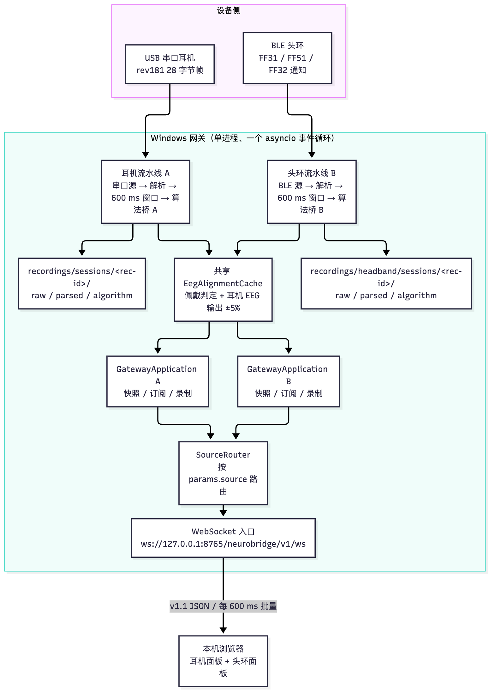

<details>
<summary>图 1 Mermaid 源码</summary>

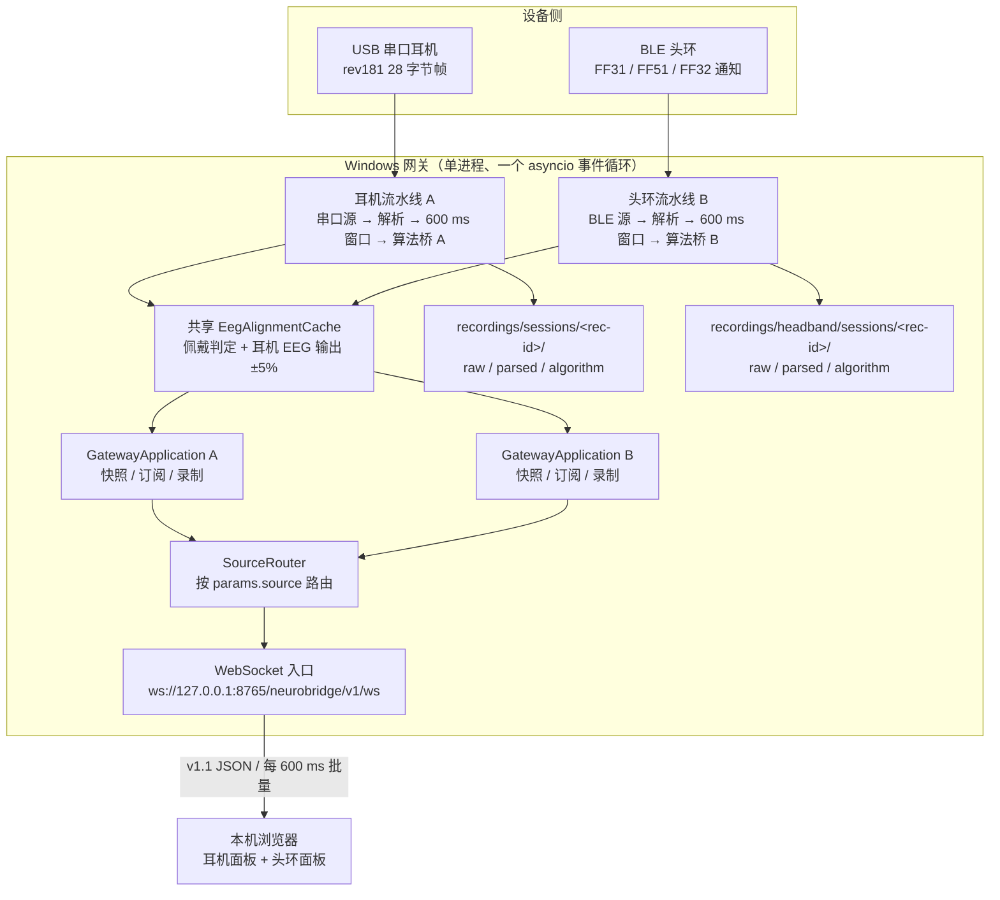

</details>

读图要点：

1. 两个容器互不共享连接、算法进程、录制仓库和订阅；同一时刻任一路断开只影响自己。
2. 原始帧在解析阶段就落盘，算法结果在算法返回后落盘，因此“算法不可用”不会丢掉原始数据。
3. `EegAlignmentCache` 是唯一的跨设备数据通道：头环只提供参考，耳机吸收参考；头环的输出不反向使用耳机结果。
4. 北向层不做设备选择，只按 `params.source` 把请求分派给对应容器的 `GatewayApplication`。

## 2. 启动与双流水线组装（图 2）

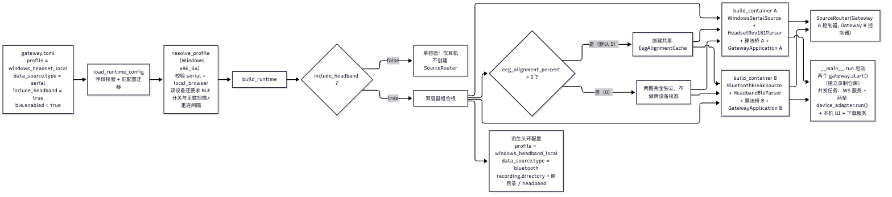

<details>
<summary>图 2 Mermaid 源码</summary>

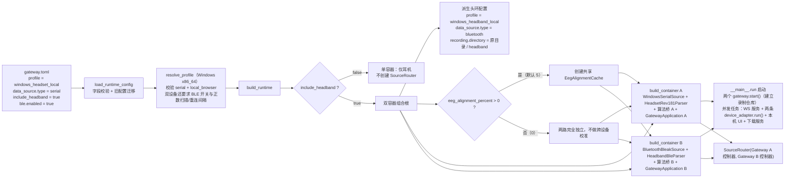

</details>

启动阶段的关键事实：

- 配置约束：`include_headband = true` 只允许搭配 `windows_headset_local` + `serial`；双设备或仅头环模式要求 `ble.enabled = true`、`scan_timeout_seconds` 和 `reconnect_delay_seconds` 都大于 0；Windows 的两套 Profile 均不支持录播，配置 `replay_recording_id` 会被拒绝；`window_interval_ms` 固定校验为 600。
- 头环容器不是“另起一进程”：它是同进程内的第二个组合，Profile 被强制替换为 `windows_headband_local`，传输改成 `bluetooth`，录制根目录切到 `recordings/headband`。
- 每个容器在 `gateway.start()` 时创建 `SegmentedRecordingRepository`，但**录制会话 ID 在对应设备连接进入 live 状态时才创建**；断开即结束该路会话，重连生成新会话。
- 启动任务：`serve(WebSocket, router)`、每条流水线的 `device_adapter.run()`、本机 UI、下载服务并发运行。设备断线/重连由适配层内部兜底，不会作为任务异常退出；但任一并发任务抛出未处理异常时，`asyncio.TaskGroup` 会取消其余任务并向上抛出，因此适配层之外不可依赖“单路异常不影响进程”。
- 生产组合使用 `neurobridge/application/gateway.py` 的 `GatewayApplication`；`neurobridge/business/gateway.py` 只是旧调用兼容门面，不在 `build_runtime` 的双设备链路中。

## 3. 耳机（USB 串口）数据流（图 3）

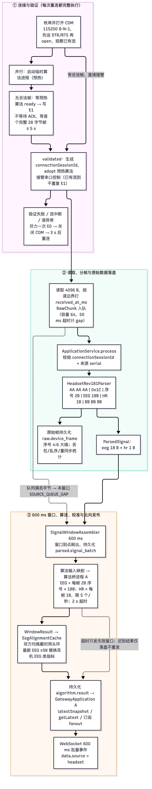

<details>
<summary>图 3 Mermaid 源码</summary>

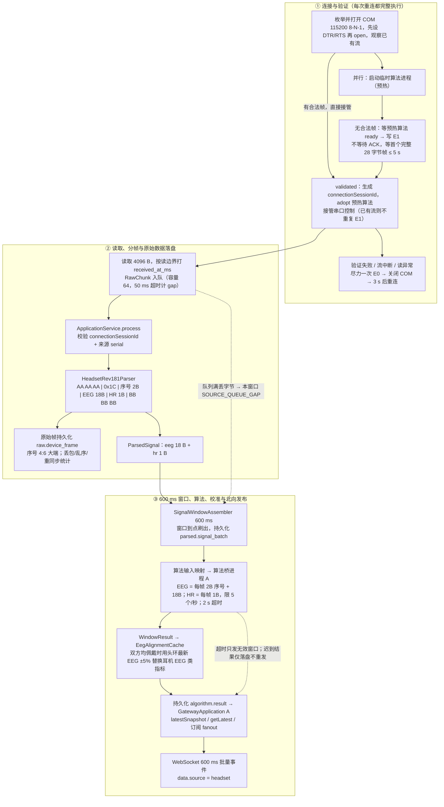

</details>

### 3.1 连接与验证

- 发现：Windows 用 `pyserial` 枚举 COM，只接受带 VID/PID 或 HWID 含 `USB` 的 USB 派生串口；`device = "auto"` 或指定 `COMn`。
- 打开：先在关闭状态设置 `DTR/RTS`，再 `open()`，避免打开瞬间电平脉冲导致耳机复位。
- 算法准备与发现/观察**并行**：候选串口打开后先观察 1 s 是否有现成合法流；没有现成流则等待预热算法 READY（期间再快速观察一次），再写 `0xE1`，然后等首个完整 28 字节帧（`data_timeout_seconds`，默认 5 s）。
- 验证判据只有一条：收到完整合法帧（`AA AA AA` + 长度 `0x1C` + 尾部 `BB BB BB`）。`0xE1` 写成功或单独 `0x01` 都不代表已连接。
- 已有合法流直接接管，不重复发 `0xE1`；接管后串口控制标记 `existing_stream`，会话准备阶段不会二次发命令。
- 候选验证失败/打开失败/观察超时：若已尝试过 `0xE1`，尽力发一次 `0xE0` 后关闭端口；状态上报 `validation_failed` 或 `not_connected`，等待 3 s 后重新扫描。
- 采集中断流：`data_timeout_seconds` 内没有合法帧即结束本会话，清理时最多一次 `0xE0`，关闭串口后重连。

### 3.2 读取、分帧与原始数据落盘

- 读取线程每次最多读 4096 字节，以读边界时间作为 `received_at_ms`；数据进入容量 64 的 `RawChunk` 队列，入队超时（默认 50 ms）会丢字节并记录 `dropped_before_bytes`。
- 有丢字节的窗口会被标记 `SOURCE_QUEUE_GAP` 并置 `valid = false`，不会把旧半帧拼到新数据上。
- `HeadsetRev181Parser` 独立维护解析缓冲：丢弃噪声、按包头/长度/包尾重新同步、对 16 位序号做丢包/重复/乱序统计；每个完整帧生成 `DeviceFrame`（原始 28 字节不变）和两条 `ParsedSignal`（18 B EEG、1 B HR）。
- 每帧在解析时立即以 `raw.device_frame` 落盘（含原始字节、序号、来源 chunk id），供后续对账和回放分析；它不依赖算法是否可用。
- 另有 `HeadsetEegDiagnostics` 在算法前统计原始 EEG 的 `all_zero`/`all_ff`/`near_adc_rail` 形态，只写日志、不修改数据；可选 `transport_trace` 会按会话字节上限记录传输原始 chunk，默认关闭。

### 3.3 窗口、算法、校准与发布

- 600 ms 窗口由 `SignalWindowAssembler` 按 `received_at_ms` 切桶；定时器在窗口结束时间触发刷出，跨桶信号也会触发上一个窗口结束。窗口批次写 `parsed.signal_batch`。
- 算法输入映射：
  - EEG：每帧取 `raw[4:6]`（序号）+ `raw[6:24]`（18 B EEG），拼接后 Base64；
  - HR：每帧取 `raw[24]`，按窗口时长限制为每秒最多 5 个值；
  - 输入保留原始字节序，不做重采样。
- 算法桥是独立子进程；同一路同一时刻最多一个活跃桥，串口每轮重连会先预热一个临时桥再 adopt，每次新设备会话 `initialize` 都会 stop/start 重建。桥使用行分隔 JSON 协议、只允许一个在途请求，默认 2 s 超时；失败/超时/积压分别产出 `ALGORITHM_ERROR`、`ALGORITHM_TIMEOUT`、`ALGORITHM_BACKLOG` 的无效窗口，迟到结果只写 `algorithm.late_result`，不重发。
- 校准：双设备且 `eeg_alignment_percent > 0` 时，耳机窗口先经过 `EegAlignmentCache`；校准后的结果同时用于 `algorithm.result` 落盘和北向发布。原始帧与解析批次永远保留校准前的设备原值。
- 发布：`GatewayApplication` 更新 `latestSnapshot`、广播状态、按订阅过滤后通过 fanout 发送；每个窗口一条 `data` 事件，节奏为 600 ms 窗口。

## 4. 头环（BLE）数据流（图 4）

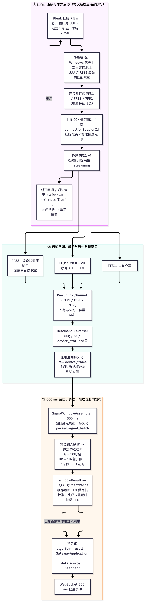

<details>
<summary>图 4 Mermaid 源码</summary>

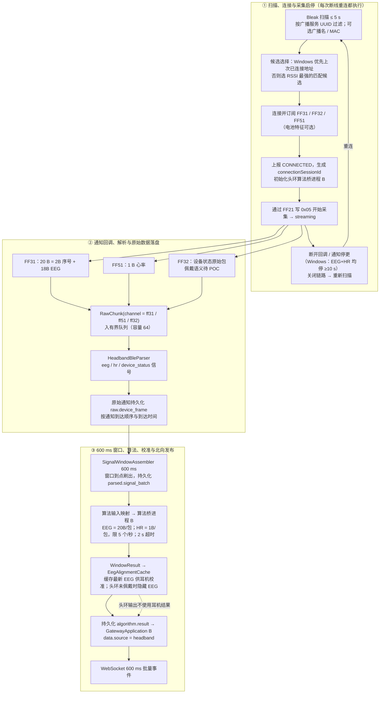

</details>

### 4.1 扫描与连接

- Windows 使用 Bleak 的 WinRT 后端扫描；默认 5 s、按广播服务 UUID（`advertisement.service_uuids`，默认 `0000ff10-1212-abcd-1523-785feabcd123`）匹配，可选 `device_name` 和 `device_identifier`（MAC）进一步过滤。
- 多个同型号候选时按 RSSI 选择；Windows 断线重连优先复用上次成功连接的地址，重连失败则回退到完整扫描。
- 连接后先订阅 FF31（EEG）、FF32（设备状态）、FF51（心率）；电池特征存在才订阅，电量百分比映射未验证前不输出数值。

### 4.2 采集启停与算法会话

- 通知订阅完成后，源先上报 `CONNECTED` 连接事件，网关随即创建该路录制会话，再初始化头环的算法桥进程。
- 通知订阅建立后，回调即可把字节放进 `RawChunk` 队列（此时连接会话已存在）；应用层要等算法会话准备完成（`_ready` 闸门）才开始处理，因此 `FF21 0x05` 之前若已有通知，也可能落入首个窗口。设备正常情况下在 `0x05` 后才出数。
- 正常停止：写一次 `FF21 0x06`，再断开 BLE；断线/停更重连时不会补发开始命令，重连成功后按新会话重新初始化。
- Windows 特有：连接建立前启动 HCI 事件诊断，只记录控制器事件摘要、原因码和参数，不记录蓝牙地址或 EEG/HR 载荷。

### 4.3 通知解析、窗口与算法

- 三个通知通道各自生成一条 `ParsedSignal`：`eeg`（20 B，含 2 B 序号）、`hr`（1 B）、`device_status`；FF32 原始状态包按 `device_status` 信号入库，其佩戴语义仍待设备 POC 确认；网关对外广播的佩戴展示状态另由原始 EEG 判定（见第 5 节）。
- 每条通知生成一个 `DeviceFrame`（原始字节）并立即落盘；600 ms 窗口、算法输入映射、算法桥、校准、落盘、发布与耳机链路结构一致，只是算法桥进程与录制目录独立。
- 头环算法输出**不吸收**耳机结果；它只把自己的最新 EEG 类指标存入共享缓存，供耳机校准。

## 5. 双设备佩戴判定与 EEG 校准（图 5）

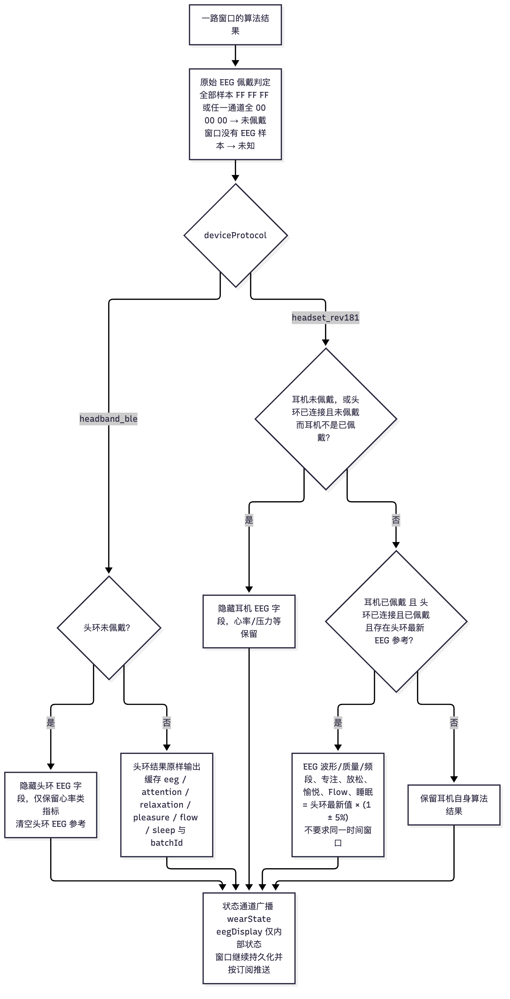

<details>
<summary>图 5 Mermaid 源码</summary>

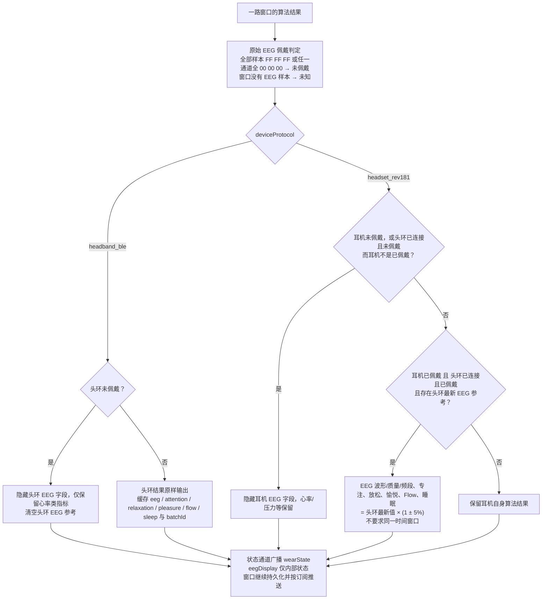

</details>

### 5.1 佩戴判定

- 只看原始 EEG 采样字节，不看序号和心率：全部样本为 `FF FF FF`，或左/右任一通道全为 `00 00 00`，判为未佩戴；窗口内没有任何 EEG 样本时状态为“未知”，不改变上一次结论。
- 耳机样本按 18 B（6 个 3 B 样本）解析，头环样本跳过 2 B 序号后按同样规则解析。
- 佩戴判定结果中，`wearState` 会随 `status` 事件广播（仅在算法有结果、校准开启时）。当算法桥不可用、走 `ALGORITHM_UNAVAILABLE` 分支时，窗口不执行佩戴判定与校准，因此不会更新 `wearState`、头环参考或隐藏规则；原始数据仍照常落盘与发布。`eegDisplay` 只写入网关内部状态：当前 `getStatus`/status 投影不含该字段，`data.payload.display` 也不会在 live 订阅投递重建时保留，因此北向客户端实际可见的是 `wearState`、`valid` 与全 FF 提示；这是当前实现的已知差距，建议后续单独修复。

### 5.2 显示与校准规则（当前分支实现）

| 场景 | 头环输出 | 耳机输出 |
| --- | --- | --- |
| 耳机已佩戴、头环未连接 | 不适用 | 保留耳机自身结果 |
| 耳机已佩戴、头环连接且佩戴 | 原样输出，缓存最新 EEG 类指标 | EEG 类字段替换为头环最新参考值并做 ±5% 随机波动；心率/压力/HRV/和谐度/激活度保留耳机自身值 |
| 耳机已佩戴、头环连接但未佩戴 | 隐藏 EEG 类字段 | 保留耳机自身结果（不被头环影响） |
| 耳机未佩戴（头环未连接或已连接） | 未连接时不适用；连接且已佩戴时原样输出 | 隐藏 EEG 类字段，仅保留心率类字段 |
| 双方均未佩戴 | 隐藏 EEG 类字段 | 隐藏 EEG 类字段 |
| 关闭校准（`eeg_alignment_percent = 0`） | 各自独立输出 | 各自独立输出 |

注：耳机原始 EEG 尚无结论（未知）且头环已连接但未佩戴时，代码同样会隐藏耳机 EEG；耳机未佩戴且头环未连接时，耳机 EEG 直接隐藏。

- 校准是**算法输出层**处理：只改变发布和落盘的算法指标，不改变原始帧、解析批次和算法输入。
- 耳机被校准的字段：`eeg`（波形 `wave`、`quality`、`bandPower`）、`attention`、`relaxation`、`pleasure`、`flow`、`sleep`；心率 `hr`、压力 `pressure`、和谐度 `coherence`、激活度 `arousal` 不跨设备。
- 波动规则：对头环参考值中的每个有限数值在 `[0.95, 1.05]` 区间内随机取值。标量字段（`attention`/`relaxation`/`pleasure`）参考缺失或为 0 时保留耳机原值；`flow`/`sleep`/`eeg` 映射字段参考缺失时会被置空为 `{}`。
- 当前分支**不等待同一窗口**：耳机窗口到达时直接使用“头环最近一次成功窗口”的 EEG 参考；也不做逐样本时间对齐（旧字段 `eeg_alignment_output_wait_ms`、`eeg_alignment_reference_batches`、`eeg_alignment_clock_packets` 仍被配置解析和校验，但不参与当前校准逻辑）。
- 关闭校准后两路完全独立；`eeg_alignment_percent` 当前只作为开关使用：设为 0 关闭，1–10 与默认 5 的行为相同，EEG 类输出的波动幅度固定为 ±5%，不影响心率。

## 6. 北向：单 WebSocket 入口、双来源路由（图 6）

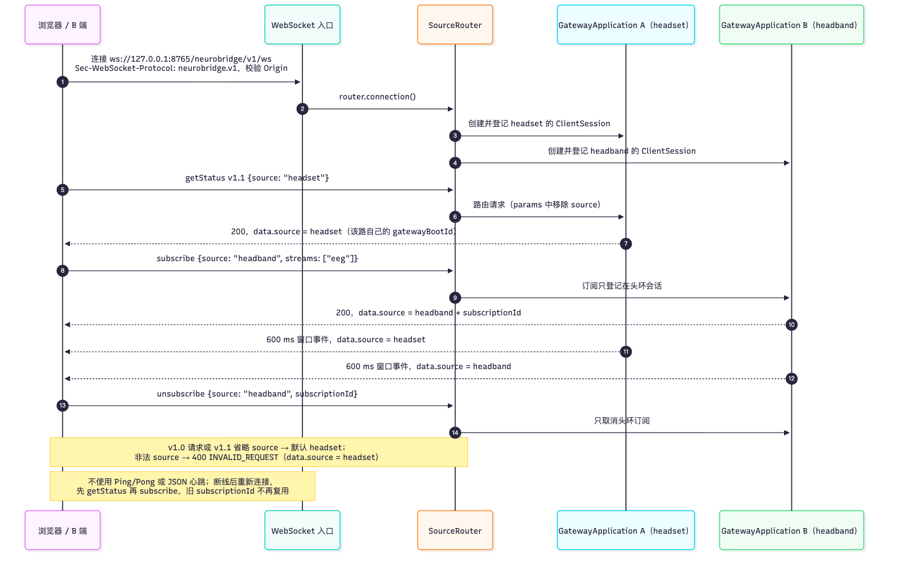

<details>
<summary>图 6 Mermaid 源码</summary>

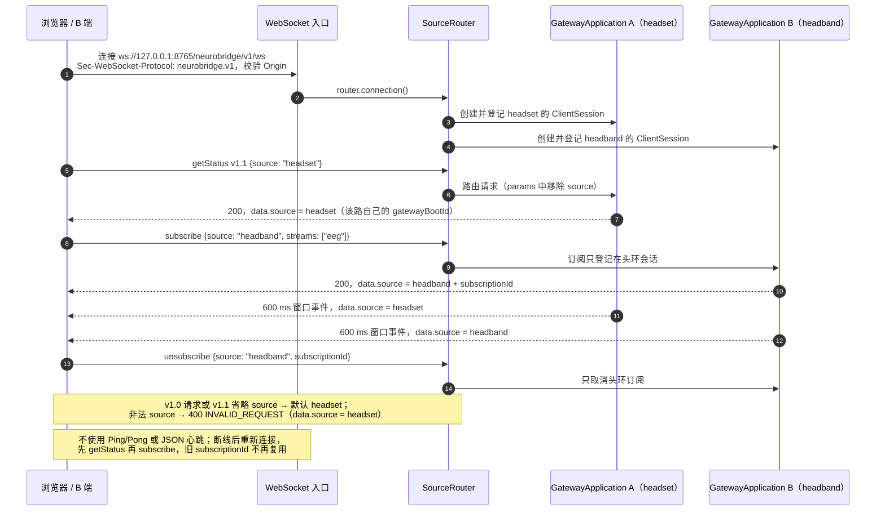

</details>

- 入口：`WS + UTF-8 JSON`，默认 `ws://127.0.0.1:8765/neurobridge/v1/ws`，要求子协议 `neurobridge.v1`、校验固定 Origin、只监听回环地址；不发送应用层保活。
- 请求版本：
  - v1.1 请求可用 `params.source` 选择 `headset`/`headband`；省略时默认耳机；`data.source` 出现在每条 v1.1 响应和事件中。
  - v1.0 请求没有来源字段，路由固定到耳机容器，响应保持旧结构（无 `data.source`）；若 v1.0 请求携带 `source`，会按未知参数返回 `400 INVALID_REQUEST`。
  - 非法 `source` 返回 `400 INVALID_REQUEST`，错误报文 `data.source = headset`。
- 会话隔离：同一 WS 连接上两路各有独立 `ClientSession`；订阅上限、重复流检查、`subscriptionId` 均按来源独立；`unsubscribe` 只对建立订阅的来源生效。
- 数据面：`getLatest` 读该路最新快照，`subscribe` 后按 600 ms 窗口推送 `data` 事件；`includeInvalid=false` 时无效窗口不推送；`status` 流推送连接/佩戴/算法状态。
- 状态：`connectionState` 最终把 `validated`/`connected` 映射为 `connected`，把 `discovering`/`connecting`/`validating` 映射为 `connecting`，其余映射为 `disconnected`；`status` 事件的 `payload.status` 只含 `connectionState`、`wearState`、`batteryPercent`、`signalQuality`、`algorithmState`。两路各有一个 `gatewayBootId`，`subjectId` 取同一部署配置。
- 离线与录播：两路 Profile 的 `supports_replay = false`，`mode` 恒为 `live`；设备未连接时 `getLatest` 与含数据流（`eeg`/`hr`/`eeg.raw`/`hr.raw`）的 `subscribe` 返回 `409 STREAM_NOT_AVAILABLE_REASON`，`getStatus` 和仅订阅 `status` 仍可用，不会回退到历史录制。
- 本机页面：`/` 联调台按来源生成两个面板并自动带 `params.source`；`/capture/` 原始数据页分别订阅两路原始流；`/downloads` 同时索引耳机与 `headband/` 子目录的录制。

## 7. 单个 600 ms 窗口的处理时序（图 7）

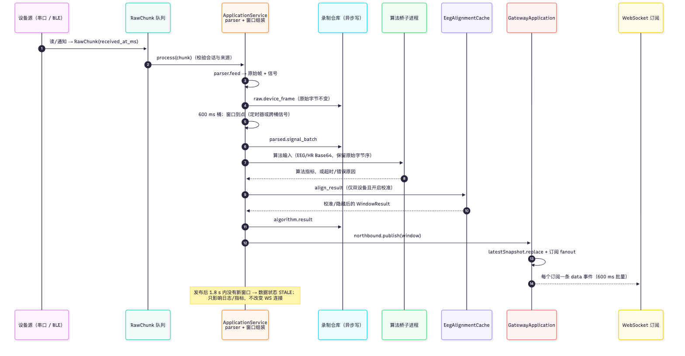

<details>
<summary>图 7 Mermaid 源码</summary>

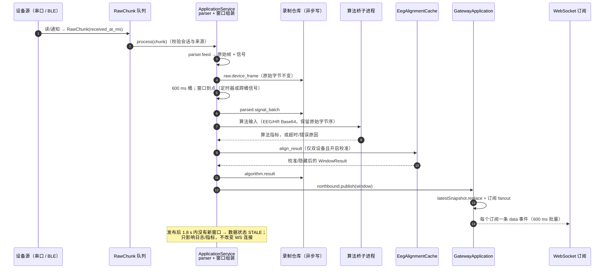

</details>

补充规则：

- 窗口内所有数据包、信号、帧引用保留在 `ParsedSignalBatch` 中；窗口 `valid` 由解析有效性和算法有效性共同决定，订阅方可按 `includeInvalid` 选择是否收到无效窗口。
- 持久化顺序：原始帧 → 解析批次 → 算法结果；每次 `try_append` 若写入队列拥塞会返回未保证落盘的收据，窗口事件仍发布，但 `persistenceGuaranteed` 会变为 false（目前只写入内部状态与日志）。
- 算法超时不会阻塞该窗口的发布：立即产出无效窗口；但超时的在途任务仍占着聚合器槽位（`max_slots` 硬编码 8）和算法桥的单请求锁，要等迟到结果返回才释放。连续超时可能先耗尽槽位、再让后续窗口变成 `ALGORITHM_BACKLOG` 或级联超时。

## 8. 异常、重连与降级行为

| 场景 | 触发/检测 | 网关行为 | 北向或日志表现 |
| --- | --- | --- | --- |
| 串口无候选 / 打开失败 | 枚举为空或打开异常 | 等待 3 s 后重新扫描 | `connectionState` 为 `disconnected`；日志记录候选数与原因 |
| 串口首帧验证超时 | 写 `0xE1` 后 5 s 无合法帧 | 尽力 `0xE0` → 关闭 → 重连 | `validation_failed` → 北向 `disconnected` |
| 串口采集中断流 | 5 s 无合法帧 / 读异常 | 结束会话，最多一次 `0xE0`，关闭后重连 | 该路事件停止；重连后新 `connectionSessionId` |
| 串口队列拥塞 | `RawChunk` 入队 50 ms 超时 | 丢字节并记录 gap，窗口标记 `SOURCE_QUEUE_GAP` | 窗口 `valid=false`，`invalidReasons` 含 `SOURCE_QUEUE_GAP` |
| 串口噪声/坏帧 | 包头、长度、包尾不匹配 | 丢弃并重新同步，不影响后续合法帧 | 解析诊断日志与丢包统计 |
| BLE 扫描无匹配 | 5 s 内没有广播服务 UUID 匹配的设备 | 等待重连间隔后重试 | `connectionState` 为 `disconnected`；日志区分“无广播/无型号匹配/名称或地址不匹配” |
| BLE 连接失败 | 连接或订阅异常 | 标记失败候选，重试/重新扫描 | `disconnected`；优先尝试其他候选 |
| BLE 断开回调 | GATT 断开 | 关闭旧链路，Windows 下立即重新扫描 | `disconnected` → 新会话 |
| BLE 通知停更 | Windows 下 EEG 与 HR 都停 ≥ 10 s | 主动断开并重连，即使系统仍显示已连接 | 日志 `notificationTimedOut=True` |
| 算法禁用 / 不可用（UNAVAILABLE） | 算法进程不可用且不属于初始化失败 | 串口已有验证流时仍继续采集原始数据（冷启动未验证出流则不会发 E1、也不会开始采集）；BLE 允许无算法启动采集 | `algorithmState=unavailable`；算法流不可用、原始流可用；该分支不执行佩戴判定与跨设备校准 |
| 算法初始化失败（ERROR） | `initialize` 返回 error | 仍按窗口尝试评估；串口已有验证流时继续采集原始数据；BLE 允许启动采集 | `algorithmState=error`；评估结果为无效窗口；佩戴判定与校准仍会执行，但指标通常为空 |
| 算法超时 / 积压 / 异常 | 2 s 超时、在途槽位耗尽、输入或桥异常 | 立即产出无效窗口；迟到结果只落盘，在途槽位与桥锁占用到迟到结果返回 | `invalidReasons` 为 `ALGORITHM_TIMEOUT`/`ALGORITHM_BACKLOG`/`ALGORITHM_ERROR` |
| 存储降级 | 磁盘水位或写入失败 | 继续采集与发布，记录持久化缺口 | 内部 `storageState`/`persistenceGuaranteed` 与日志 |
| 数据过期 | 窗口发布后 1.8 s 无新窗口 | 数据状态转 `STALE`，连接不断开 | 日志 `Data stream became stale`；`getLatest` 标记无效 |
| 浏览器断线 | WS 关闭 | 清理该连接上两路会话和订阅 | 不做 Ping/Pong；客户端重连后先 `getStatus` 再重新 `subscribe` |
| 非法来源 | `params.source` 非 headset/headband | 不路由到任何容器 | `400 INVALID_REQUEST`，`data.source=headset` |

## 9. 录制与文件布局

双设备模式每路一个独立录制根，耳机与头环使用不同录制会话：

```text
<recording.directory>/
├─ sessions/
│  └─ rec-<uuid>/               # 耳机（容器 A）
│     ├─ manifest.json          # 分段清单、起止时间、SHA-256
│     ├─ raw/000001.jsonl       # raw.device_frame 等原始记录
│     ├─ parsed/000001.jsonl    # parsed.signal_batch
│     └─ algorithm/000001.jsonl # algorithm.result / algorithm.late_result
└─ headband/
   └─ sessions/
      └─ rec-<uuid>/            # 头环（容器 B），结构相同
         ├─ manifest.json
         ├─ raw/
         ├─ parsed/
         └─ algorithm/
```

- 录制会话在对应设备进入 live 状态时创建，设备断开时关闭；重连生成新的 `rec-<uuid>`，不会把两次连接写入同一会话。
- 每条记录带录制会话 ID、窗口起止时间或采集时间；原始帧、解析批次、算法结果通过 `batchId`/`frameId` 关联。
- 分段默认按 600 s 或 256 MB 切分，写入队列 1024，定期 fsync；完成的分段落盘为 `000001.jsonl`，写中为 `.partial`。
- 下载服务 `/downloads` 聚合耳机与头环两套 `GatewayApplication` 的已完成录制；日志导出独立于录制目录。

## 10. 关键参数与配置

| 配置项 | 默认值 | 生效位置/说明 |
| --- | --- | --- |
| `profile` | `windows_headset_local` | 双设备主 Profile；头环容器由组合根强制为 `windows_headband_local` |
| `data_source.type` | `serial` | 主传输；头环容器为 `bluetooth` |
| `data_source.include_headband` | `true`（模板） | 开启双容器与 `SourceRouter` |
| `data_source.window_interval_ms` | `600` | 固定校验值，窗口与 600 ms 发布节奏一致 |
| `data_source.stale_after_ms` | `1800` | 数据过期判定，须大于窗口长度 |
| `data_source.eeg_alignment_percent` | `5`（双设备默认） | `0` 关闭跨设备校准；非 0 即开启，范围 0–10，实际波动幅度固定 ±5% |
| `data_source.eeg_alignment_output_wait_ms` | `800` | 配置仍被解析校验，**当前分支不生效** |
| `data_source.eeg_alignment_reference_batches` | `16` | 配置仍被解析校验，**当前分支不生效** |
| `data_source.eeg_alignment_clock_packets` | `4096` | 配置仍被解析校验，**当前分支不生效** |
| `serial.baud_rate` | `115200` | 8-N-1；`dtr/rts=false` |
| `serial.handshake_timeout_ms` | `1000` | 观察已有流的时长 |
| `serial.data_timeout_seconds` | `5` | 首帧验证与断流判定 |
| `serial.reconnect_delay_seconds` | `3` | 串口重连间隔 |
| `serial.max_buffer_bytes` | `65536` | 解析缓冲上限，超出丢最旧字节 |
| `ble.scan_timeout_seconds` | `5` | 每轮扫描上限 |
| `ble.reconnect_delay_seconds` | `3` | BLE 重连间隔 |
| `ble.notification_timeout_seconds` | `10` | Windows 通知停更判定（EEG+HR 均停） |
| `ble.model_nbr_uuid` | `0000ff10-...` | 头环型号广播 UUID |
| `algorithm.request_timeout_ms` | `2000` | 算法桥单次请求超时 |
| `pipeline.algorithm_queue_size` | `8` | 窗口算法批次队列容量；聚合器在途槽位另为硬编码 8，不受此项控制 |
| `pipeline.source_queue_size` | `64` | 设备源 `RawChunk` 队列容量 |
| `pipeline.source_enqueue_timeout_ms` | `50` | 入队超时即计 gap |
| `server.host` / `port` / `path` | `127.0.0.1` / `8765` / `/neurobridge/v1/ws` | 单 WS 入口 |
| `local_ui.port` | `8080` | 本机联调台与 `/capture/` |
| `download.port` | `8766` | 录制/日志下载 |
| 耳机 HR 限制 | 5 个/秒 | 算法输入映射 |
| 头环 HR 限制 | 5 个/秒 | 算法输入映射 |
| 耳机 EEG 波动幅度 | ±5% | `eeg_alignment_percent` 当前只被读取为开关/范围，实际波动固定 5% |

> 采样率、每 600 ms 的实际样本数、算法输入分组细节仍属双方待确认项，代码不假定固定值：窗口按实际收到的帧/通知分组，算法输入按窗口内实际包数拼接。

## 11. 源码索引

| 关注点 | 位置 |
| --- | --- |
| 双设备组合根 | `neurobridge/bootstrap/container.py:360` |
| 单容器装配（源/解析器/算法/网关） | `neurobridge/bootstrap/container.py:242` |
| 进程启动与并发任务 | `neurobridge/__main__.py:40` |
| 串口源（Windows） | `neurobridge/adapters/sources/serial_windows.py:16`、`:88` |
| 串口会话（验证/E1/E0/读取/分帧） | `neurobridge/serial/adapter.py:216`、`:287`、`:477`、`:582` |
| 串口控制（会话绑定 E1/E0） | `neurobridge/adapters/sources/serial_control.py:11` |
| 耳机 28 字节解析 | `neurobridge/adapters/parsers/headset_rev181.py:22` |
| BLE 源 | `neurobridge/adapters/sources/bluetooth_bleak.py:25` |
| BLE 扫描/连接/通知/控制 | `neurobridge/ble/flowtime.py:69`、`:137`、`:349`、`:416` |
| 头环通知解析 | `neurobridge/adapters/parsers/headband_ble.py:12` |
| 应用服务（会话、窗口、持久化、发布） | `neurobridge/application/service.py:31`、`:202`、`:274`、`:474` |
| 窗口组装 | `neurobridge/application/windowing.py:10` |
| 算法输入映射和结果聚合 | `neurobridge/application/processing.py:17`、`:73` |
| 双设备佩戴与校准 | `neurobridge/application/eeg_alignment.py:53`、`:70`、`:92`、`:122` |
| 算法桥进程 | `neurobridge/algorithm/runner.py:18`、`:176` |
| 北向网关（状态/查询/订阅/发布） | `neurobridge/application/gateway.py:54`、`:145`、`:189`、`:399`、`:456` |
| 请求路由与会话隔离 | `neurobridge/adapters/northbound/controller.py:26`、`:126` |
| WebSocket 监听与鉴权 | `neurobridge/northbound/websocket.py:27` |
| 本机页面与注入配置 | `neurobridge/northbound/local_ui.py:86`、`:195` |
| 录制仓库（sessions 根、分段写入） | `neurobridge/adapters/storage/filesystem.py:58`、`:86`、`:303` |
| 录制会话与事件索引 | `neurobridge/adapters/storage/archive.py:25` |
| Profile 与能力 | `neurobridge/profiles/resolver.py:44`、`neurobridge/profiles/windows_headset_local.py`、`neurobridge/profiles/windows_headband_local.py` |
| 版本与协议版本 | `neurobridge/version_registry.toml:45`（报文 v1.1，兼容 v1.0）、`neurobridge/versioning.py` |

## 12. 与仓库现有描述的差异（重要）

当前分支在 `a4771fa` 把双设备校准从“逐样本时间配对/同窗等待”改成了“头环最新 EEG + ±5% 波动”，但以下描述和测试没有同步：

| 位置 | 现状 | 与当前代码的差异 |
| --- | --- | --- |
| `README.md:131` | 仍写“按估算的采样时间逐点配对”“使用同一接收窗口的头环参考” | 当前不配对、不要求同窗 |
| `windows/README.md:73`–`:87` | 仍写逐点配对、800 ms 等待、`eeg_alignment_output_wait_ms`/reference/clock 配置生效、`flow_fallback` 等日志 | 当前实现不使用这些逻辑；三个配置字段虽仍解析校验但不参与校准 |
| `windows/gateway.toml.example:38`、`:40`–`:41` | 注释描述“从窗口结束等待头环结果 800 ms”“参考批次上限”“时间模型包观测上限”等旧行为 | 字段保留，注释需按当前实现更新（36–37 行的 `eeg_alignment_percent` 说明仍有效，但“5% 校准”实际是固定 ±5%） |
| `tests/integration/test_application_pipeline.py` 的双设备校准用例 | 期望 `mappingVersion=2`、`pairedSamples`/`waveTolerancePercent` 日志、±5% 限幅后的具体数值 | 当前 `AlgorithmInputMapper.MAPPING_VERSION=1`，测试在 tip 上失败（实测 `AssertionError: '1' != '2'`） |
| `tests/unit/test_eeg_alignment.py` | 已按“最新头环 + ±5% 波动”更新 | 与当前实现一致，8 个用例通过 |

建议后续单独提交同步上述文档注释与集成测试；本次只新增本流程图文档，不修改已发布对外协议，也不改版本台账。

## 13. 验证状态与边界

- 本文基于源码静态梳理；`tests/unit/test_eeg_alignment.py` 在当前分支通过（8/8）。
- 双设备校准集成测试在当前分支 tip 上因上述旧断言失败，属于测试未同步，不是本图论证依据。
- 未在 Windows 目标机上重新执行真实双设备采集、拔插/重连、服务重启与浏览器断线恢复；这些仍是现场验收项，不能据本文写成“已验收通过”。
- 本文不涉及银河麒麟串口交付链路、BLE 录播、B 端专网等历史方案；相关边界以版本台账与预发布协议为准。
- 图 1–7 的嵌入预览使用 PNG（`doc/tech/assets/windows-dual-device/figure-*.png`），同目录保留同名 SVG 矢量版供缩放查看；两者均由各图折叠块中的 Mermaid 源码渲染，修改图后需同时重新渲染。
