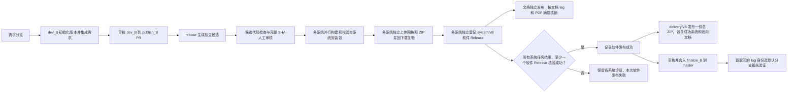

# NeuroBridge 发布工作流技术方案

- **依据**：[发布工作流 PRD](../product/发布工作流%20PRD.md)、`release/release_matrix.toml`
- **状态**：实施方案；本地构建与 CI 证据、真机验收分别记录

## 1. 源码版本列车与触发

源码配置为 `.release/code-release-train.toml`，基于 source-version-train 的配置模板适配本仓库；编排工具为 `python -m tools.source_train`。默认分支从 GitHub 元数据解析并与配置核对，当前为 `master`。`B` 只能为规范的三段数字版本；不接受 latest、前导零、预发布后缀或任意分支名作为版本。

需求分支 `feature/*`、`bugfix/*`（兼容当前 `codex/*`）保持开发基线版本。用户明确选择 B 和需求列表后，`initialize` 从新取回的默认分支 SHA 初始化 `dev_B`，记录 `.release/train.json`，更新唯一版本源 `[application].version` 及其维护的 pyproject/麒麟运行时模板；旧平台字段是 legacy 元数据，不作为构建计数器递增。重用同一 train 校验版本、基线和选定需求，不重置分支或重复升版。无独立构建计数器调整，候选也不再改版本。

`select` 只为已存在 train 的明确需求范围创建 feature-to-dev PR。全部选定 PR 合入且代码门禁通过后，`promote` 创建或重用唯一开放的 `dev_B → publish_B` PR。`publish_B` 初始指向版本初始化之前的默认分支基线，只允许经过审核的 PR 更新。合入 publication PR 本身不打包、不发版。

合入后的 `prepare` 将 publication SHA rebase 到本次取回的默认分支上，生成 `release-candidate/B/attempt`。该候选独立于可见 publication 分支，永远不作为 PR 来源；不回写、强推或重写 `publish_B`。新候选必须重新通过全部源码门禁，并由用户通过 `review` 显式审核完整候选 SHA，才可操作 `release`。最终通过独立 `finalize_B → master` PR 合入，并只使用 merge commit 保留原提交。

`ci.yml` 对需求、dev、publish、候选、finalize 和默认分支运行代码校验，保留默认分支要求的 `unit-and-websocket` 名称。需求分支与其 fork 基线比较版本；dev/publish 与记录的初始化基线比较；候选和 finalize 还校验状态记录、版本及祖先关系。普通 push、PR、手动 Test 都不发布。`release.yml` 只提供精确 SHA 的打包接口及手动诊断候选入口；`kylin-bootstrap.yml` 仅手动运行。

版本门禁显式接收 GitHub 事件类型。PR 固定使用目标分支 SHA；普通快进 push 保留 `before` 基准。新分支或 rebase/强推导致 `before` 缺失或不再是当前提交祖先时，重新核对 GitHub 默认分支与仓库配置并拉取精确 SHA，需求分支以它和当前提交的共同祖先校验版本，发布阶段仍使用其元数据基线。默认分支自身遇到不可恢复的 push 基准时明确失败，防止以当前提交与自身比较而漏检；默认分支不匹配、拉取失败或非法 PR 基准同样拒绝。日志记录基准回退原因和解析出的 SHA。

### 源码列车自动检查

`source-train-checks` 是源码列车配置中的必需代码检查：在 Ubuntu / Python 3.11 上对 CI、源码编排、Release、Kylin bootstrap 四个工作流运行固定版本 actionlint，并用 `tools/check_source_train_workflows.py` 交叉检查各阶段分支覆盖、必需检查名称、普通事件不能进入打包流程，以及可复用工作流的调用方/被调用方权限。Windows 启动验证任务同时在 Windows / Python 3.11 运行列车契约测试；Ubuntu / Python 3.12 的完整测试发现继续覆盖同一套测试。PyYAML 仅登记在 `requirements-ci.lock`，不加入网关运行时依赖。

本地验证命令（Python 3.11 或 3.12）：

```bash
python -m pip install -r requirements-ci.lock
python -m tools.check_source_train_workflows
python -m unittest discover -s tests/source_train_contracts -v
```

故障测试使用临时裸 Git 远端与全新 runner 克隆，覆盖检查点恢复候选对象、同 SHA 重试、并发分支推进时整批清理拒绝、成功后的证据保留、等树但 squash 历史的拒绝、合并冲突、tag 前后失败保留，以及包回执过期/缺失/不确定时阻止重复打包。托管 API 由本地替身提供，删除比较使用真实 Git 原子 ref 事务；不访问真实发布目的地，不替代 workflow token 权限与目标机交付验收。新增检查会进入源码列车门禁；仓库管理员维护的默认分支保护规则不由这些测试自动修改。

### 启用前置条件与操作入口

当前改造只提交源码与配置，不修改线上 Secrets 或 Rulesets，也未选择或创建实际版本列车。源码、系统和文档发布统一使用触发本次工作流的 `GITHUB_TOKEN`，不使用 GitHub App。仓库设置需允许 GitHub Actions 创建 PR（Allow GitHub Actions to create and approve pull requests），否则 `gh pr create` 会被拒绝；该 token 创建的 PR 作者是 `github-actions[bot]`，工具按该身份校验。该 token 产生的 push、PR 或 tag 事件不会启动新的 workflow；`dev_B -> publish_B` 或 `finalize_B -> master` 合入后，当前运行显式调用 `workflow_dispatch` 交接下一步。同样地，prepare 推送候选分支、finish-systems 推送 finalization 分支后，工作流显式触发该分支的 `Test`，否则候选和最终 PR 永远拿不到必需检查。review、release、merge 在检查仍在运行时会等待（上限 30 分钟），检查缺失或失败立即阻断。调度失败时保留现场，由操作者重跑对应操作。默认分支审批数量为 0；工具要求至少 1 个批准，并使用保留候选的 merge commit。

### 分支保护严格校验（可选）

工作流 token 的权限集不含 Administration，无法读取 Rulesets 或经典分支保护。若希望在源码写入前完成严格校验，创建仅限本仓库、`Administration: Read-only`（Metadata 只读自动附带）的 fine-grained PAT，保存为 Actions Secret `TRAIN_PROTECTION_TOKEN`；工作流只用它读取保护规则，写操作和 PR 作者仍使用 `GITHUB_TOKEN`。未配置时保护状态显示“未确认”，由 GitHub 在合入时强制；PAT 需在到期前轮换，组织仓库可保存为组织级 Secret。

发布 workflow 需要 Contents、Pull requests 写入，Actions 写入与读取，以及 Checks 读取权限。工作流 token 无法获得读取 Rulesets 和经典分支保护所需的 Administration 读取，因此 Actions 中的保护检查会记录为“未确认”，由 GitHub 在合入时强制；具备管理读取权限的本地身份仍执行至少一个批准、保留 merge commit、禁止线性历史的完整校验。默认分支、`dev_*` 与 `publish_*` 要求 PR、至少一个批准及代码检查；`publish_*` 禁止直接更新。`release-state/*` 只允许受信发布身份写检查点；禁止外部改写。默认分支允许 merge commit，并且不能采用仅允许线性历史的最终合入策略。`finalize_* → master` 的必需检查必须真实运行。仓库级自动删除 PR 来源分支必须关闭；受保护 dev 分支的删除权限需允许发布 workflow 在祖先校验后执行清理。代码不会替管理员修改这些保护规则。

在 Actions 的 `Source version train` 中依次操作，版本必须由用户明确输入，不提供自动选版：

| 操作 | 输入/结果 |
| --- | --- |
| plan | 选择目标版本和待预览源码，可填写 `systems`，列出安装包、文档交付范围、候选检查和列车配置；只读，不执行写入 |
| initialize | 选择 B、需求分支列表；初始化或验证 dev_B，publication 从初始基线建立 |
| select | 在已初始化且范围一致的 train 中创建或重用需求 PR；评审后由正常 PR 合入 |
| promote | 全部需求已合入并检查通过后，创建或重用 dev_B → publish_B PR |
| prepare | 对已合并的 promotion PR 生成候选，并显式触发候选分支的 `Test`；合入事件自动触发，也可按 PR 编号重试 |
| review | 输入完整候选 SHA，记录有仓库写权限的人类审核者；等待候选必需检查完成并通过 |
| release | 检查恢复记录、审核、保护及代码门禁，锁定所选系统版本，再调用打包/发布接口 |
| merge | finalize PR 获批准、检查通过且来源提交核对后，显式使用 --merge 和期望 head SHA 合入 |
| verify | 重新从远端取回默认分支和 tag，核验身份与祖先关系后才清理临时分支；合入事件也触发 |

选好目标版本后，可先运行 Actions 的 `plan`，用 `plan_source` 指定完整提交 SHA 或 `origin/需求分支`。本机对应的只读命令是 `python3.11 -m tools.source_train plan --version <B> --head <ref>`。它展示指定提交的实际应用版本、每项安装包、各 PDF 的文档版本及交付位置，并检查列车分支的审批规则、Actions Secrets 是否存在，以及已记录候选的代码检查和人工审核状态。Secrets 存在性不验证 App 安装或密钥有效性，读取权限不足时报告未确认。所有源码写操作均须显式 `--execute`，Actions 写操作还必须使用触发本次运行的工作流身份。

打包工作流在版本门禁后生成同一提交的 `release-preflight.json`。正式软件包采用已验证的正式文档 PDF；迁移前沿用台账指定的历史总包基线。评审模式可以使用候选中的待发布文档。

如果接入行为变更要求补文档，在对应的 `change_records` 加入 `required_document`，填写文档键 `key` 和最低目标版本 `minimum_version`，可用 `pull_request` 关联文档 PR、用 `platforms` 限定适用平台。软件预检检查待办登记并列出目标版本和随包版本。新版尚未发布时，软件可以先发，软件回执保留待办。报文变更但正式协议未更新且缺少对应登记，或所选系统发现未登记的待发布文档更新时，预检阻断。ZIP 上传前核对所有实际随包 PDF 的版本和 SHA-256。

软件发布后，在 `master` 启动 `External document release`，输入文档键、已在文档 PR 批准锁定的版本、这次要核销的正式软件 tag。软件的公开 Release 和回执验证通过后，工作流渲染及检查 PDF，创建 `docs/<文档键>/v<版本>`（键中的下划线转换为连字符）。公开的 `document-receipt.json` 记录文档 tag、PDF SHA-256、软件 tag 和核销的变更 ID。可用 `python -m tools.document_release verify --document <键> --version <版本>` 回下载核对。草稿上传中断后沿用已验证的原始 PDF，软件发布记录独立保留。

## 2. 构建输入与矩阵

矩阵来自 `release/release_matrix.toml`：Windows 10/11 × x86_64 × EXE/MSI 共 4 个目标；麒麟只有一个目标 `kylin-v10-all-deb`，`package_kind = "bootstrap"`。合计 5 个目标。麒麟不再按服务器版/桌面版、五种架构和 DEB/RPM 预先构建。每个目标有稳定 ID、独立构建目录和日志。Windows 7 与 x86 32 位不在发布矩阵内，不构建，不产生空归档。

正式列车按 `systems` 选择系统版本。可选值为 `windows-10`、`windows-11`、`kylin-v10`，多项用逗号分隔。指定一个 Windows 版本会同时选择 EXE 和 MSI。参数为空时使用 `release/release_matrix.toml` 的 `[selection].default_systems`。该列表为空时，各系统与自己上次交付的源码比较。Windows 专属改动覆盖 Windows 10/11，麒麟专属改动覆盖麒麟，共用业务代码改动覆盖两平台。仅升版、文档或 CI 改动时，自动模式可能不选择任何安装包，可按需显式指定系统。

例如预览 Windows 11 可运行 `python3.11 -m tools.source_train plan --version 0.4.0 --head <提交> --systems windows-11`。预检、构建和回执校验都从同一候选提交读取发布矩阵。首次打包前将系统范围和基准写入 `release-state/<版本>`，后续重试使用该范围及原候选 SHA。构建中间归档保留在 `artifacts/release`，正式交付 ZIP 单独写入 `artifacts/delivery` 供回执校验和上传。手动运行 `Release` 也可指定 `systems`，省略时仍使用全量诊断矩阵。

产物构建不得从现有 `build-product-candidate.py` 的源码 ZIP/TAR 伪装安装包。Windows 的 MSI/EXE 由 WiX MSI/Burn 分别生成。未填写 `native_input_run_id` 时，Release 各 Windows 目标直接准备锁定 Python/算法运行时，安装 WiX 7.0.0 及匹配扩展，调用 `tools/build-native-package.py` 输出安装包、`verification.json` 和日志到本目标的输入目录，再调用既有 `release_pipeline.py target` 校验并复制到汇总目录。显式填写时仍下载指定运行的原生安装包，并校验分支、源码提交及成功状态；不使用独立 unsigned 源码候选 ZIP。麒麟引导包由 Release 自己在 ubuntu runner 上调用 `tools/build-kylin-bootstrap-package.py` 生成，不下载 `neurobridge-input-<targetId>`，也不需要麒麟 runner 上预先编好的运行时。包内携带 Python 3.11、wheel、CMake 和 Eigen 3.3.7；运行时在安装该包的银河麒麟 V10 实际目标架构机器上构建。`tools/write-kylin-bootstrap-verification.py` 写出符合 [`release-target-verification.schema.json`](../../schemas/release-target-verification.schema.json) 的 `verification.json`，其中 `runtimeSha256` 与 `inputSha256` 都是包内离线输入目录的摘要。打包按分支最新提交执行：手动触发时使用所选分支的 head SHA，源码流程调用时使用已审核候选的不可变 SHA；Windows 输入运行的分支、SHA 和成功状态必须对应。Windows 外部输入缺失或校验失败时记录 `blocked`/`failed`；直接构建由 `release_pipeline.py build-windows` 按 runtime、toolchain、license、extension、toolchain-version、package 阶段执行：子进程失败时停止该目标的后续阶段，记录 `failed`、具体阶段和退出码，目标作业继续完成结果收集与上传，再由汇总按两平台最低包数决定是否可发布。无法写入结果/日志等基础设施错误仍使作业失败。安装包自动校验与目标机验收分别记录，未通过校验的包不纳入平台 ZIP。

### 麒麟引导包安装生命周期

以下行为属于 PR #15 的源码修复与模拟回归范围，尚未在银河麒麟 V10 x86_64 上完成安装包验收。

- **首次安装与串口权限：**允许未接耳机时运行 `dpkg -i`，日志明确标记 `waiting_for_device`，服务等待接入。安装器检查实际 `/dev/ttyACM*`、`/dev/ttyUSB*` 字符设备，为服务账户追加节点的非 root 所属组；不授权 root 组。另安装 `70-neurobridge-usb-serial.rules`，只匹配 USB 祖先下的 ttyUSB/ttyACM 节点，为其设置 `neurobridge` 组和 `0660`，后续插入无需重装。服务账户加入该组；规则重新加载后只触发这两类串口的 change 事件，不触发其他设备。现有同名非本包规则或软链接拒绝替换，权限设置失败仍中止。该规则涵盖这两类 USB 串口，不推测耳机 VID/PID；现场须确认与其他串口工具的权限策略相容。安装成功仍不代表合法帧采集通过。
- **升级与同版本重装：**每次 `configure` 都构建并部署当前包内源码，不再用已有 Python 文件判断是否跳过更新。构建与暂存期间原服务继续运行；替换程序前先正常停止并确认退出，使原录制及 E0 收尾使用旧代码。已有服务保留原来的运行、自启状态；首次安装启用并启动服务。配置、日志和录制数据保留。
- **安装成功与服务状态：**`INSTALL_END exit_code=0` 仅表示安装事务完成。旧服务为 stopped 时，升级会保留停止状态，包括已 enabled 但未运行的服务；安装阶段名 `activate-service` 不能作为服务启动证据。日志明确记录 enable/keep_disabled、start/skip_start 及原因；跳过启动时输出 `installed_not_started`、`startup_verified=false` 和手动启动、状态、journal 命令。只有实际执行 start 且 is-active 成功时才输出 started；该即时检查仍不能替代持续运行、真实串口与重启验收。
- **回滚：**分别保存原服务单元、运行状态、自启状态、程序目录与本包旧权限规则。安装失败恢复原文件及状态，重新加载恢复的规则；首次失败移除本次新增程序、配置、服务单元与权限规则。回滚自身失败时输出错误与备份目录并保留备份，不能表述为已恢复。
- **Python 选择：**运行时归档调用 Python 准备脚本时指定 `NEUROBRIDGE_PORTABLE_PYTHON=1`，即使系统已有 Python 3.11 或更新版本，也使用随包校验的解释器和 cp311 wheel。普通源码部署仍可以选择符合要求的系统解释器。
- **卸载：**DEB 的 `prerm remove` 停止并确认服务退出，再取消自启；`postrm remove/purge` 只删除匹配本安装路径的服务单元并执行 `daemon-reload`，另清理含本包标记的串口规则并重新加载。停止失败时拒绝卸载；升级维护钩子和其他源码部署的同名服务保持不变。`/opt/neurobridge`、现场配置、日志与录制数据保留。构建器兼容 RPM 的卸载钩子采用同样规则，RPM 不属于当前正式发布矩阵。

目标机验收必须覆盖：无耳机首次安装及后续接入、已接耳机的首次安装、实际服务组/节点权限及合法帧；授权失败后的重试与旧规则恢复；已有 Python 3.11 时的离线构建；运行中与已停止服务升级；启动失败回滚；卸载后整机重启不再启动网关；以及串口离线且存在历史录制时不启动录播、拔插重连、服务重启与浏览器断开恢复。模拟工具不能代替这些结果。

历史部署指南 v1.0 与 v1.1 已锁定，不回写。v1.1 要求安装前连接耳机；本次修复允许无设备安装并通过热插入规则授权，只更新实现、内部说明及未发布变更记录，后续获文档发布授权再新增下一版本。

总包根目录由 `build-release-bundle.py` 根据实际交付清单生成 `bundle-directory-guide.pdf`，中文标题为“NeuroBridge 交付包目录说明”，面向部署人员列出各层 ZIP、解压顺序、安装包、指南、日志工具和核验资料位置；不再交付根目录 `PRD.md`。复用 `render-protocol-pdf.sh` 的 Pandoc/Chrome 与中文字体工具链，PDF 纳入 `bundle-manifest.json.documents`，缺失、渲染失败或不是 PDF 时阻止交付；汇总 CI 验证中文字体并渲染全部页面作为独立预览 Artifact，PDF 与预览均不提交 Git。Windows 保持 10/11 x64；麒麟引导按 PRD 七个架构 Profile 选依赖，新架构仍待真机验收。麒麟运行时模板版本及文件名由版本台账同步，版本门禁检查这两个字段，防止引导包与本地运行时归档版本不一致。

### 独立版本与文档晋升

`[application].version` 标识源码列车和交付总包。台账 `[software_versions]` 分别配置 Windows 10、Windows 11 和麒麟 V10 的安装包及正式软件 tag 版本。PR CI 比较目标分支和 PR 的版本及相应代码。某系统升版时要求本 PR 有影响该系统的实际代码或构建输入变更。版本未变的系统跳过正式发布，手动指定范围同样执行版本筛选。业务代码改动而所有系统版本均未变化时门禁不报错：本次列车记录 `skipRelease` 后结束，不产出安装包，改动随该系统下一次升版的列车交付。发版时再次与各系统上次正式交付比较。

各文档保留已发布版本和可选的内部预发布稿。北向协议沿用 `documents.internal_prerelease`，其余文档使用 `document_prereleases.<key>`。在需求 PR 用 `python3 tools/create-protocol-prerelease.py --document <key> --version <版本>` 建立下一版草稿。在文档发布 PR 用 `python3 -m tools.promote_document --document <key> --version <版本> --date YYYY-MM-DD` 晋升。脚本新增带版本号的正式 Markdown 和台账条目，登记发布记录与锁定区间并移除已晋升稿。PR 的必需检查 `unit-and-websocket` 在选择 PDF 版本前对照目标提交校验文档历史，拒绝已发布版本的文件或元数据改动、只有元数据变化的升版，以及晋升后残留预发布稿。北向协议晋升还须通过同一检查中的 PDF 构建和逐页渲染，产物随 PR CI 上传。手动运行 Test 并指定 `protocol_version` 可生成对应已登记版本的 PDF Artifact。

## 3. 候选、包与最终合入



每个系统要求自己的全部安装包通过校验，Windows 任一 EXE 或 MSI 缺失只会让对应 Windows 系统失败。各系统分别打包发布，其他系统无须等失败任务恢复。共用文档和本平台部署指南按台账随包交付，后续独立文档 Release 的结果不影响软件发布。

`source_sha` 必须为完整候选 SHA。每个系统先上传 `train-package-receipt-<SHA>-<system>`，再上传 `verified-release-<SHA>-<system>`。系统工作流回下载核验后，在 `<system>/v<softwareVersion>` 登记软件 ZIP 和 `software-receipt.json`。各分支结束后，汇总读取公开 Release 和回执，至少一个系统通过核验即记录软件发布成功并固定本轮结果。最终合入核验成功系统的 tag。全部失败时保留同一候选和诊断，重试优先复用已有产物。部分成功时，失败系统仍沿用上一次成功交付的基准，可在后续列车纳入范围。

`delivery/vB` 绑定同一候选提交，发布一份 `neurobridge-vB.zip`。它从固定结果取回所有成功系统的原始 ZIP 和对应回执，把软件 ZIP 放入 `systems/<system>/`，随包 PDF 及目录说明放入 `docs/<system>/`。根目录的 `bundle-directory-guide.pdf` 拼接各成功系统已渲染的目录说明，以对应 ZIP 路径作为书签。清单记录成功和失败系统、实际文档版本、正式 tag（如有）、摘要和待办。ZIP 写完后复验各成员摘要，Release 上传后回下载复验。尚未发布的文档新版继续由独立流程核销。交付总包上传失败时该 job 直接失败，不再以绿灯跳过；可在同一版本重跑 `publish-delivery`，软件结果沿用已登记的结果。历史 `vB` 总包仍可读取。

最终 PR 来源为 `finalize_B`，起点为记录的候选/tagged SHA。`merge` 操作不使用 squash、rebase-and-merge、--admin 或强推；默认分支前移时允许保留候选提交的合并更新，必须重跑检查和审批，禁止在 finalize 追加新的普通需求提交。默认分支受保护且不允许所需合入方式时，在打包前阻断。

`verify` 禁用本地 replacement/graft 影响，显式远端 fetch 默认分支及 tag、忽略本地缓存 tag，要求 peeled tag 等于已发布候选 SHA，且 `git merge-base --is-ancestor` 返回成功。还核对 finalization PR 使用 merge commit。最终合入还要求合并结果与“已打包候选 + 当前默认分支”的无冲突合并树一致，防止仅靠 merge parent 数量放过未打包修改。只有这些检查通过才标记完成并清理 dev、隐藏候选和 finalize；dev 的提交须已纳入 publication，候选与 finalize 须仍指向已验证提交。删除使用 GitHub updateRefs 的 beforeOid 原子校验，任一分支被推进则全部保留，避免删除新工作；可见 publish 和状态记录保留。PR 显示 merged、树内容相等或本地分支已包含 tag 均不足以完成发布。

## 4. 重试、回执与权限

`release-state/B` 的 `attempt.json` 保存 publication SHA、默认分支基线、候选 SHA、审核者、包来源/摘要/Artifact ID、GitHub Release 发送状态和最终 PR。每次状态提交同时以候选提交和上个检查点为 parent，采用普通快进 push；即使临时候选分支已删除，候选 Git 对象及旧检查点仍可取回。整个仓库的源码操作串行，防止自动 prepare、显式 release 和最终 verify 同时覆盖记录。

重试首先查远端 tag 和持久记录。输入未变直接恢复同一候选，不重新 rebase，不重新初始化版本。若检查点已保存但候选分支推送中断，prepare 重试恢复记录中的同一 SHA；远端分支指向其他提交时保留并阻断。已有成功 Artifact 则取回原字节，跳过打包/再次上传；上传中断时按已记录运行 ID 查找同名 Artifact 并对照上传前回执进行 reconciliation。回执已存在但原包不可恢复、保留期已过、远端查询失败、已有 tag 无可信记录或源输入改变时阻断，要求人工做新的发布决定，不能假装未发送并重发。恢复运行中记录的产物缺失、过期或不唯一时直接失败，不静默跳过该系统发布。GitHub Release 的 success 不重复发送，uncertain 则通过既有同提交/同摘要检查恢复。

打包或发布失败且尚未打 tag 时，保留状态 ref 与包证据后删除临时候选分支，dev 和 publish 保留；重试恢复同一候选。失败清理查询锁定范围内的所有系统 tag，任一 tag 存在时保留 tag 和所有涉及分支，包括 Release 上传失败的情况。已记录的 tag 消失或指向其他提交时阻断，不能重建或移动它。Artifact 与包回执保留 90 天，过期或丢失时须人工恢复并核验，不能自动重新发版；GitHub Release 作为长期下载入口。

App 承担源码分支、PR、tag 和合入写操作；普通代码验证与打包只读源代码，打包工作流本身不拥有创建 tag 的步骤。发布/包检查不代替银河麒麟或 Windows 实机验收。

## 5. 日志与验收

每个目标写 UTF-8 结构化结果，至少包含 `targetId`、状态、阶段、时间、runner、工具链、输入摘要、包文件/摘要、自动验证与未验证原因；文本日志保留命令的退出码和错误摘要。不得输出令牌、密码、私钥、完整人体原始数据。发布前验证所有选中目标均有合格安装包、包字节与清单一致、ZIP 可解压且内层摘要一致。Windows 10/11 与麒麟引导包的真机安装、回滚、串口及离线无 replay 证据仍分别验收。

## 6. 当前仓库可执行边界

仓库已有 x64 Windows 算法构建、源码候选包脚本和麒麟引导包构建脚本，但没有 Windows x86/7 兼容运行时和 WiX 离线工具链。麒麟不再要求五架构 sysroot 或预先编好的运行时：引导包在 ubuntu runner 上打包，运行时留到安装它的银河麒麟 V10 实际目标架构机器上构建。本次交付范围是版本门禁、5 个目标的规划、目标证据检查、归档与发布状态机。Windows 原生安装包默认在 Release 当前运行构建，也支持显式选择通过校验的外部输入运行；麒麟引导包独立构建。构建失败保留目标日志，外部输入缺失记录 `blocked`/`failed`，均不作为合格安装包。每个系统必须拿到本系统全部目标的合格包才创建 tag 或 GitHub Release；只在所有系统都未通过时判定整次软件发布失败。手动打包的非正式构建不创建 tag 或 Release。托管 runner 的 EXE/MSI 构建和汇总通过后，仍须补齐 Windows 10/11 与银河麒麟各目标的安装、升级、回滚和真实采集验收；源码候选包不参与原生包数量门禁。

### 安装失败取证与交付文件名

麒麟引导包每次配置均执行构建，记录 `/var/log/neurobridge-bootstrap/install-*.log` 中的版本、源码提交、阶段和退出码，清理临时构建目录前保留其子日志；日志导出脚本不依赖网关运行时或网页。DEB 增加 `make` 系统依赖，离线部署须预先准备全部系统依赖。Windows 每个可用系统 ZIP 随附 `install-with-logs.ps1`，支持 MSI/Burn 日志和离线失败日志导出。原生包收集拒绝矩阵外输入，家族和架构没有安装包时不创建空 ZIP。

## 诊断身份、环境与架构边界

支持表及扩展准入见[PRD §2.7–2.9](../product/发布工作流%20PRD.md#27-系统与-cpu-架构支持表)。引导 DEB 标识为 all，按系统/CPU/ABI 选择锁定输入；x86_64 用既有预编译依赖，其余六个 Profile 用本机源码构建。详细条件与状态见 PRD §2.7–2.8，all 不代表跨架构运行时通用。

`windows/diagnostic-context.ps1` 与 `packaging/kylin/diagnostic-context.sh` 供安装/运行导出共用。原生载荷与麒麟安装生成的运行时保留 `build-info.txt`（应用版本、源码提交）；Windows 版本 ZIP 另附同源 `build-info.txt` 与上下文模块。导出从部署目录读软件身份，从包目录读本次安装包身份，不混用；无台账/构建信息或 Python 不可用时为 `unknown`。版本字段为磁盘文件身份，配合独立服务状态使用。

上下文包含诊断类型/UTC 时间、版本与提交、OS 名称/版本/构建、CPU 架构/系统位数、Python 版本/位数；Windows 另记 PowerShell 和导出进程位数，麒麟另记内核/glibc/Bash。麒麟运行时载荷包含 `/opt/neurobridge/kylin/export-logs.sh` 及模块；安装诊断在尚未部署运行时时也可生成。网页日志下载与 Windows 摘要使用 Python 共用上下文，明确为已加载模块及导出进程环境。麒麟综合采集器分别标识采集器源码和已部署目录，不将采集器版本当作服务版本。全部上下文只读取必要字段，不导出配置正文或全量环境变量。

用户提供的旧总包 PDF 文件名已有 UTF-8 ZIP 标记，旧解压器仍可能误解码。用户交付 ZIP 使用 ASCII 文档副本名，元数据保留其与台账原名的映射；PDF 字节不因此改写。旧已发布 PDF 与 Markdown 不回写，Windows/麒麟指南各新增独立 v1.1 并保存历史版本元数据。


## 多架构依赖供应与日志

`config/kylin-bootstrap-inputs.toml` 是架构映射和输入摘要的唯一清单；`tools/prepare-kylin-bootstrap-inputs.py` 默认仅验证，可由开发人员显式 `--download` 准备 `.runtime/kylin-bootstrap-inputs`。Actions 的 `Prepare Kylin dependencies` 仅由人工触发，下载锁定 URL 并按 SHA-256 验证后保存依赖缓存，不构建安装包。Release 只恢复相同清单摘要的缓存并复验，缺失或污染立即失败。本轮不触发这些任务。

打包器验证全部 Profile 输入后复制到引导载荷；仅保留串口所需的通用 wheel，生成匹配的校验清单。维护脚本不联网获取依赖。系统开发库须在 dpkg 配置包前由管理员/软件中心准备，避免维护脚本持有包锁时再调用 apt。Python 源码构建在模块检查通过后才继续，CMake 与算法输出、config.log/CMake日志在临时树删除前转存。运行时归档 manifest 写入真实架构，安装器先校验 OS/CPU，再验证摘要和解释器 ABI/模块，随后才修改账号或服务。

日志新增 UTC phase 事件：detect_host、selected_profile、verify_input、toolchain、build_python/complete、build_cmake/complete、algorithm_build、verify_runtime_identity 和各 setup_end 的耗时/退出码；失败带稳定原因（unsupported_os/cpu/abi、abi_bitness_mismatch、compiler_target_mismatch、missing_or_unsafe_input、input_hash_mismatch）。安装与运行导出继续包含包/部署版本、源码提交和 OS/CPU/Python 环境，不包含配置正文或人体数据。

### Windows 目标失败隔离与构建日志（2026-10-29）

`build-windows` 将每个阶段的 stdout/stderr 写入 `artifacts/targets/<targetId>/windows-build.log`，将实际构建结果写入同目录的 `build-outcome.json`。原生构建器捕获的 WiX 完整输出另从输入目录复制为 `native-validation.log`，因此即使未生成 `verification.json` 也可取证；三个文件与 `result.json` 随 `release-target-<targetId>` Artifact 上传。成功包继续使用原有验证清单、原生格式、源码提交和摘要校验；构建结果本身不能绕过校验。

目标失败保留原始阶段和原因。单个 EXE/MSI 构建失败只阻止该系统发布，其余系统可继续；所有选中系统失败时，发布汇总才失败。重建前清除旧验证记录与原生构建日志，避免把上次成功包误算为本次成功。回归覆盖各阶段失败、日志保留、部分成功及全部失败。

### 业务源码升版规则（2026-10-29）

PR #21 仅调整发布链路和测试，应用版本恢复为当前正式版本，撤回此前未发布的候选升版记录。门禁排除 CI、`tools/`、打包与安装脚本、依赖清单、文档及 `neurobridge/version_registry.toml` 的记录性变更，同时保留真实业务源码变更的升版、兼容性和版本回退检查。源码删除或移出运行目录仍按源码变更判定。

发布基线继续取带总 ZIP 的已公开正式 Release：本次版本与基线相同，`shouldRelease=false`。`external-documents`、`product-candidates`、`release-targets`、`release-aggregate` 和 `release-publish` 均显式依赖该输出为 true；同版本合入只记录跳过，不重新打包、不创建/移动 tag、不覆盖已发布资产。回归覆盖既有公开 tag 的同版本 CI 合入、真实业务代码必须升版、版本回退及所有发布作业的条件门禁。
